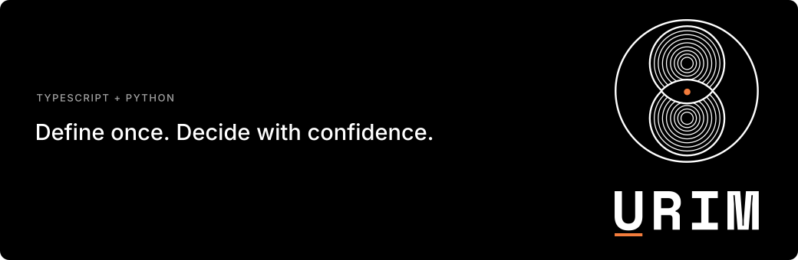

<picture>
  <source media="(max-width: 600px)" srcset="assets/brand/urim-readme-header-mobile.svg">
  
</picture>

# Urim

**Urim is a client library for decision models.** You define a decision once in code, call it through a chain of provider tiers, and get typed answers that say where their confidence came from.

Decision models take application state plus typed questions (yes/no, choice, score) and return typed answers with probabilities. Vendors expose them through incompatible request bodies and different confidence definitions. Urim keeps the provider's values as they are and derives portable fields next to them.

> **Status: alpha — for examination and evaluation only; not production-ready.** The first alpha is available for TypeScript ([npm `@voidal-ubiety/urim` 0.0.1-alpha.1](https://www.npmjs.com/package/@voidal-ubiety/urim/v/0.0.1-alpha.1)) and Python ([PyPI `urim` 0.0.1a1](https://pypi.org/project/urim/0.0.1a1/)). Two provider adapters exist, one for the `systemone` request format and one for the `decisions` request format (`openaiDecisions`). Both are tested against mocked HTTP only. **No live provider call has been made yet**, so there are no measured accuracy, latency or cost numbers. Six more providers have descriptors (wire format, URL, auth) but no adapter.

## What v1 has

- **`defineDecision` in code.** Tiers, an input schema, questions (`noul`, `choice`, `score`), failover rules and named thresholds are plain data. Input schemas: Zod in TypeScript (optional peer), pydantic v2 in Python (optional extra), or neither.
- **`urim emit`** writes the canonical JSON of each decision plus its hash.
- **`urim fit`** fits per-tier cutoffs from labelled cases and writes `urim.lock`. It stops at a cost estimate unless you pass `--yes`.
- **`urim providers`** generates the frozen provider constants from a registry file.
- **`urim.lock`** is optional in development and required in prod mode, where the decision's hash must match the lock.
- **Tiered fallback with a budget skip.** Tiers are tried in order on the error types the decision lists. Before a call, a tier whose estimated input cost would exceed the budget is skipped; the estimate uses the UTF-8 byte length of the request body.
- **`confidenceSource`** on every answer: `"native"` (the vendor's own value), `"urim_derived"` (computed client-side) or `null`.
- **`confidenceFormula`** on every answer: `"systemone_normalized"` (Urim's |2p − 1| for yes/no, the `systemone` request format's normalized formula), `"vendor_unspecified"` (the vendor's number; Urim does not assert its formula) or `null`.
- **Typed errors.** One `UrimError` with a closed set of `type`s (`auth`, `timeout`, `rate_limited`, `budget`, `all_tiers_failed`, `lock_violation`, …).

Not in v1: YAML authoring, streaming, hedging or fan-out, a circuit breaker, a built-in OpenTelemetry profile, caching, and runtime registry fetches.

## Install the alpha

These packages are intended for examination, experimentation, and feedback. They are not ready for production use.

```sh
npm install @voidal-ubiety/urim@alpha   # Node >= 23.6; zod is an optional peer
pip install --pre urim                  # Python >= 3.11; extras: urim[pydantic], urim[httpx]
```

Network adapters are opt-in through a subpath, so the core never touches the network:

```ts
import { createClient } from "@voidal-ubiety/urim";
import { openaiDecisions } from "@voidal-ubiety/urim/adapters";
const client = createClient({ adapters: [openaiDecisions()], env: process.env });
```

Pass `deadlineMs` (Python `deadline_ms`) to `createClient` to set a default total deadline across all tiers; it must be a finite number > 0. A call's own `deadlineMs` overrides it, and `deadlineMs: null` (Python `deadline_ms=None`) turns it off for that call. There is no default, so by default nothing times out. Once the deadline is spent, the remaining tiers record `timeout` without being called.

Credentials are read from the named environment variable named by each provider's descriptor (for example `OPENAI_API_KEY`) at send time and never logged.

## Command line

```
urim emit <module...> --out <dir>
urim fit <module> --cases <eval.jsonl> --fake <fake.json> --lock <out> [--prices <prices.json>] [--export <name>] [--yes] [--repeat N] [--report]
urim providers --registry <registry.json> --out <file.ts>
```

Both ports ship the same `urim` command and produce byte-identical canonical JSON, hashes and envelopes, checked by the shared vectors in `packages/shared-fixtures/`.

## Repository layout

```
packages/urim-ts         npm package `@voidal-ubiety/urim` (TypeScript, ESM)
packages/urim-py         PyPI package `urim`
packages/shared-fixtures cross-port vectors both test suites assert against
packages/check.sh        the one gate: tests, lint and types for both ports
```

## Contributing and security

- [CONTRIBUTING.md](CONTRIBUTING.md): setup and how a change is made. From a clone, `scripts/dev setup` then
  `scripts/dev check` installs everything (including the `httpx` extra) and runs every test offline.
- [SECURITY.md](SECURITY.md): how to report a vulnerability.

## License

Apache-2.0. See [LICENSE](LICENSE).

Copyright 2026 David Thomason and Urim contributors.
